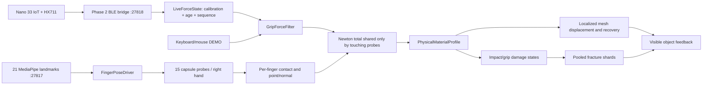

# تفاعل اليد مع الأجسام — Phase 3 / WBS 3.4.1

هذا الجزء داخل المشروع نفسه في `E:\GP\codex\GripRehab-Unity`. افتح `Assets/Scenes/GripRehab.unity` واضغط Play. في وضع التجربة الافتراضي، اجلس أو انتقل للمطبخ، اختر الجسم من لوحة الخيارات، اضغط **E** للحمل، ثم **Space** أو زر الماوس الأيسر للضغط. عجلة الماوس تغيّر القوة التجريبية، **Q** للإفلات، و**R** لإعادة الأجسام. زر **B** ينتقل إلى مصدر Phase 2؛ لا تُحتسب قوة لوحة المفاتيح حينئذ.

## أين تُعدّل؟

| الغرض | الملف أو العنصر |
|---|---|
| حساسات الأصابع الـ15 ونقطة/اتجاه/مدة التماس | `FingerContactRig.cs`, `FingerContactProbe.cs` على `RightHand` في المشهد |
| زوايا الأصابع من الـ21 landmark وحفظ آخر وضع صالح عند فقد التتبع | `FingerPoseDriver.cs` |
| القوة الصالحة وتصفيتها ومنع النبضة الشاذة | `LiveForceState.cs` ثم `GripForceFilter.cs` |
| إعداد الكتلة والاحتكاك والارتداد والتشوه والكسر لكل جسم | ستة ملفات `.asset` في `Profiles/` من نوع `PhysicalMaterialProfile` |
| حمل الجسم، التشوه المحلي، تراكم الضرر، الشظايا القابلة لإعادة الاستخدام | `SqueezableObject.cs` على كل جسم |
| موضع القبضة فوق الطاولة والربط باللعبة | `ApartmentExperience.cs` و`ApartmentSettings.asset` |
| إعادة فحص الربط المحفوظ بعد تعديل المشهد | قائمة Unity: `Grip Rehab → Verify Scene and Logic` |

اضغط على جسم مثل **Silicone ball** من Hierarchy، ثم على Profile الخاص به في Inspector لتعديل مقاومة الضغط أو نصف قطر التشوه. قيم هذه الملفات تقريبية للتصوّر وليست وصفة علاجية أو قياسًا سريريًا. لا تعدّل المواد أثناء Play إن أردت حفظ التغيير.

## حدود التنفيذ

- الكاميرا الحقيقية وجهاز Nano/HX711 غير متوفرين هنا؛ اختبارات UDP وlandmarks اصطناعية وموسومة بوضوح. دقة المطابقة الحركية والقوة المقاسة من شخص حقيقي تحتاج معايرة واختبار جهاز مستقل.
- في وضع Phase 2، انقطاع القراءة أو تبدّل المعايرة/الشكل يُفلت الجسم ويوقف تقدم التمرين خلال حد الصلاحية 500 ms؛ لا يتحول إلى قوة لوحة المفاتيح. هذا يحافظ على شروط الأمان السابقة.
- الأصابع تستخدم مفاصل العظام الموجودة مع capsules. التماس فيزياء Unity والتشوه المحلي هنا تقريب وقت حقيقي، وليس FEM أو Obi Softbody. جدار الجسم ما زال collider صلبًا؛ التشوه المرئي للشبكة لا يغيّر شكل collider في كل إطار.
- لا توجد محاكاة سوائل أو تآكل أو احتراق. الكوب الخزفي والمقرمش قابلان للكسر؛ الكرة والإسفنج والكوب السيليكوني والطماطم تستخدم ملفات مواد مستقلة.
- أدوات الإنشاء `CoreInteractionAuthoring.Install` تصلح المراجع وتُبقي تعديلات ملفات Profile الموجودة؛ لا تشغّلها عادة بعد تعديل المشهد يدويًا. مشهدك المحفوظ هو مصدر العمل.

## تشغيل الاختبارات

في Unity: `Grip Rehab → Run Apartment Play Tests (3 cycles)`. النتيجة في `Logs/editor-qa.txt` و`Logs/apartment-runtime-checks.json`. الاختبارات تشمل تماس الأصابع المستقل، تشوه رؤوس mesh القريبة فقط، قوة صفر/نبضة شاذة/قوة متكررة، سقوط الكوب، تبديل الغرفة والأجسام، انقطاع Phase 2، معايرته، وتكرار Play/Stop. `GripRehab.FingerContacts` علامة قياس داخل Unity Profiler. تُسجّل متوسط وأقصى مدة خطوة التماس في JSON؛ القياس على الجهاز النهائي مطلوب للحكم على الأداء الفعلي.
