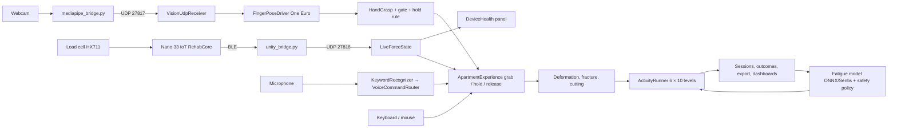
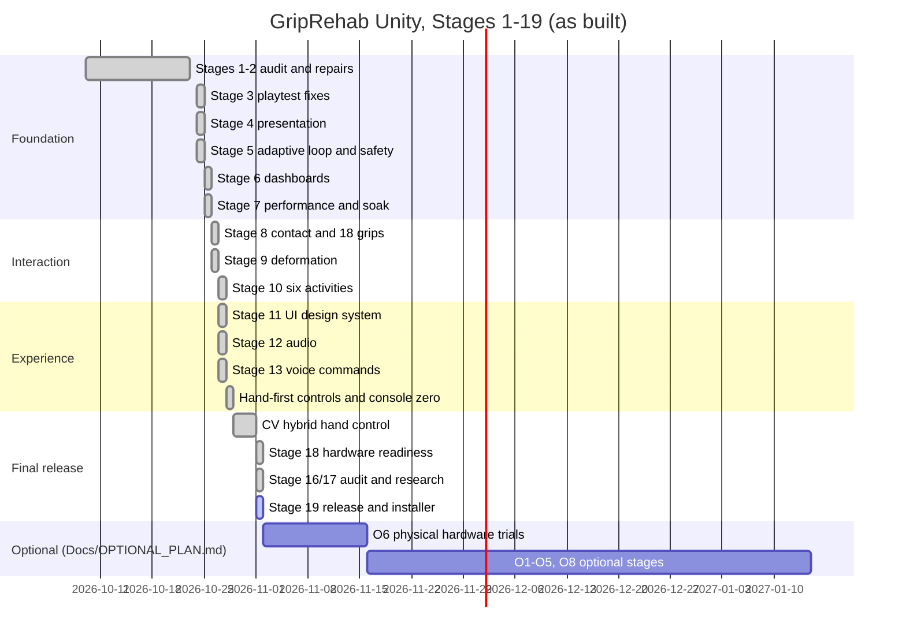

# Stage 16 audit and completion report (2026-11-01)

As-built review of the whole project before the v1.0.0 tag. "Tested" means an automated check passed on the stated input. SYNTHETIC, by-eye and physical results are kept apart. Nothing here is a clinical or physical validation.

## 1. As-built block diagram and pipeline
- **Interactive page:** [`Docs/architecture/index.html`](architecture/index.html) has the layers, the camera-hand and force pipelines, and "where does X live".
- **Full dependency graph:** [`Docs/architecture/graph.html`](architecture/graph.html), from graphify: 6026 nodes, 15445 edges, 382 communities.

## 2. As-built Gantt (dates from the git history)

**Critical path to physical evidence:** O6 hardware trials, then a real-hand camera session, then a clinical design (O7). The software path is complete.

## 3. Requirements status (`Docs/REQUIREMENTS_CHECKLIST.md`)
| Area | Stage | Status |
|---|---|---|
| Deformation | 9 | Tested (SYNTHETIC probes, by-eye gallery) |
| Hand–object contact | 8 | Tested (contact probes ×3) |
| Six activities | 10 | Tested (activity probe, 12 runs per pass) |
| UI modernisation | 11 | Tested (UI checks, contrast, layout) |
| Audio | 12 | Tested (audio probe); listening session OPEN |
| Voice commands | 13 | Tested (router offline, voice probe); microphone session OPEN |
| Eye tracking | 14 | Not started → optional O1 |
| Voice assistant | 15 | Not started → optional O2 |
| Environment upgrade | 15A | Done (by-eye): candle glare removed, calmer marble; perf and probes pass |
| Audit | 16 | This document |
| Research proposal | 17 | `Docs/STAGE17_RESEARCH.md` |
| Hardware readiness | 18 | Software tested on SYNTHETIC input; physical OPEN (`Docs/PHYSICAL_TEST_PROTOCOL.md`) |
| Release | 19 | Installer, portable zip, first-run check |

## 4. End-to-end check (start to shutdown)
The journey suite (`run_ai_player_checks.py journey`) runs the whole data path in the built player: launch, account, module, tracking frames, grasp, force, deformation, activity, results, export, quit. The final full regression results are in `Logs/final-full-regression.txt` and summarised in `Docs/ai/STATE.md`.

## 5. Gap analysis (prioritised)
| Priority | Gap | Why | Next step |
|---|---|---|---|
| Blocker for clinical use | No patient or physical data | Outside the capstone | O6, then O7 |
| Important | Real-hand camera feel and latency not measured | Needs a person and the webcam | `PHYSICAL_TEST_PROTOCOL.md` P5; add a latency meter |
| Important | Monocular depth is a proxy | Hardware limit | O5 depth camera |
| Important | A-OB1: intermittent activity grab failures in some earlier runs | Was not reproduced in the final runs; root cause not proven | Keep the 3-run activity check in regression |
| Optional | Eye tracking, voice assistant, Arabic UI | See `OPTIONAL_PLAN.md` | O1, O2, O4 |
| Future | Hybrid detector (YOLO26 + RF-DETR) | Training unfinished | O3 with an A/B |

## 6. Stability and configuration audit
- The console is 0 errors, 0 warnings and 0 logs on startup and after play, and the MCP bridge is up (ConsoleZeroCheck).
- Per-frame allocation is enforced by the perf probe. New code (DeviceStatusPanel) refreshes its text at 2 Hz only, in sensor mode.
- Every edit to a protected file has a reason recorded in `Docs/evidence/final-2026-10-29/protected-source-review.json`.
- Code review of the release diff: 10 findings, 7 fixed, 3 minor ones left (HUD state reads the score, not the gate; PlayerPrefs polled each frame; gesture classified twice per frame).
- Security review, by hand (the review skill needs a git remote): no network listeners beyond loopback UDP, no video saved, the installer is per-user with no admin rights, and the release stager copies only named files. The HTML pages build their tables with `textContent`, so there is no injection.
