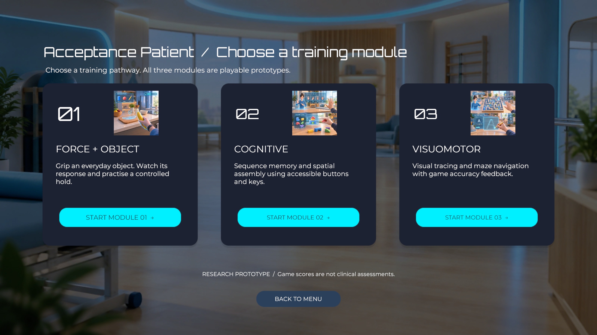

# واجهة Grip Rehab — دليل التشغيل والتعديل

افتح `E:\GP\codex\GripRehab-Unity` في Unity Hub بإصدار **6000.4.4f1**، ثم افتح `Assets/Scenes/GripRehab.unity` واضغط Play. تبدأ اللعبة بالقائمة الرئيسية، ويظل اللاعب متوقفًا، وتحاول الكاميرا المحلية تشغيل MediaPipe للتحكم في القوائم بالسبابة. أوقف Play قبل تعديل المشهد، ثم احفظه بـ Ctrl+S؛ تعديلات Play المعتادة لا تُحفظ.

## رحلة المستخدم

1. **START PRACTICE**: يفتح اختيار الموديول. عند عدم وجود ملف نشط يبدأ **Guest Practice** دون إنشاء بيانات مريض أو حفظ نتائج؛ الملف النشط الموجود يحفظ تقدمه.
2. **CREATE NEW PROFILE**: يسجل اسمًا وعمرًا واليد المراد تدريبها واليد المسيطرة. يمكن ترك الجنس، شدة الألم اليوم (0–10)، وصف صعوبة اليد، والهدف اليومي فارغة. تلك إجابات يكتبها المستخدم وليست قياسات أو تشخيصًا.
3. **SAVED PROFILES → SELECT**: يختار ملفًا محليًا موجودًا. لا توجد كلمة مرور أو حساب سحابي؛ لذا هذا اختيار ملف على نفس الجهاز، وليس تسجيل دخول آمنًا.
4. **CONTINUE PRACTICE**: يتفعّل فقط بعد جلسة محفوظة. يعيد آخر موديول؛ في Module 01 يسترجع الغرفة والعنصر واليد ومصدر الإدخال، وفي Modules 02/03 يعيد نوع التمرين من بدايته. لا يسترجع حالة الجسم الساقط أو المكسور أو التقدم اللحظي.
5. **PATIENT DASHBOARD**: يعرض بيانات الملف المختار وحقيقة وجود جلسة إعداد محفوظة. تاريخ القوة والنتائج السريرية مؤجلان إلى WBS 5.1.
6. **RESEARCH DASHBOARD**: يعرض عدد التمارين المكتملة وأفضل نتيجة لعبة من الملف النشط فقط. ليست هذه توصية طبية أو قياس قوة؛ بقية مسار الطبيب ما زالت مستقبلية.
7. **QUIT**: يوقف Play داخل Editor أو يغلق برنامج Windows المبني.

تظهر ثلاث بطاقات قابلة للفتح: **FORCE + OBJECT / 01**، و**COGNITIVE / 02** وفيه Sequence Memory وSpatial Assembly، و**VISUOMOTOR / 03** وفيه Visual Tracing وMaze Navigation. هذه تمارين بحثية أولية ونتائجها مقاييس داخل اللعبة؛ لا تتضمن YOLO أو ذكاء إرهاق سريري. Baseline assessment وfatigue-aware AI ومسار الطبيب الكامل ما زالت خارطة طريق وفق مخطط المشروع الأصلي.

## التحكم بلا ماوس

ارفع إصبع السبابة ومدّه، مع ثني إصبعين آخرين على الأقل، أمام الكاميرا. تظهر نقطة فوق الشاشة؛ حرّك إصبعك نحو الزر المطلوب، ثم ثبّته **خمس ثوانٍ** حتى تكتمل الحلقة الخضراء. لو ظهرت اليدان يختار المؤشر اليد التي تشير فعلًا، بدل تفضيل اليمين دائمًا. الحركة إلى زر آخر أو فقد التتبع يصفر العدّاد. تُدعم الأزرار والقوائم المنسدلة وخياراتها، ويمكن تتبع مسار Visual Tracing بالإصبع. كل ذلك يعتمد على MediaPipe المحلي؛ إذا تعذّر فتح الكاميرا يبقى الماوس والكيبورد كما كانا. إنشاء ملف شخصي يحتوي حقول كتابة ويحتاج مساعدة أو لوحة مفاتيح؛ للبدء دون كتابة اختر Start وضع الضيف. لا تُحفظ صور الكاميرا بواسطة مؤشر القوائم.

## داخل Module 01

- الشريط العلوي يعرض اسم الموديول وزر الرجوع. بطاقة **Station identity** أعلى اليسار تعرض الغرفة واليد. بطاقة **Live input card** أعلى اليمين تعرض المصدر والقيمة: **% إغلاق بصري** مع الكاميرا، **newtons** مع القوة المقاسة الصالحة، أو **newtons** لقوة Keyboard Demo الاصطناعية. نسبة الإغلاق ليست نيوتن. عند غياب عينة Phase 2 صالحة يظهر `--` و`PHASE 2 · WAITING`، ولا تتحول اللعبة تلقائيًا إلى قوة الكيبورد. شريط التقدم يعرض نسبة الإغلاق في وضع الكاميرا أو زمن الإمساك المتحكم فيه في وضع Demo/Phase 2.
- بطاقة **Context guidance** أسفل اليسار تعرض الجسم المختار أو المحمول وتعليمات تتغير حسب حالة الإمساك ومصدر الإدخال. بطاقة **Quick controls** أسفل اليمين تلخص أهم الاختصارات. تُترك مساحة الوسط للّيد والجسم. القيم المرئية تأتي من حالة اللعب الفعلية عبر `RehabAppShell.UpdateTelemetry`، وليست أرقامًا زخرفية.
- زر **MAIN MENU** يحفظ إعدادات الجلسة الحالية، يترك الجسم المحمول، يغلق عامل الكاميرا، ويعود للقائمة.
- **TAB** أو **ESC** يفتح/يغلق لوحة الخيارات أثناء اللعب. اختر **LIVING ROOM** أو **KITCHEN**، ثم أحد العناصر الثلاثة المتاحة في الغرفة، واليد Right/Left، ومصدر الإدخال Camera / Demo / Phase 2. **RESUME** يعيد الحركة.
- **WASD** للحركة، الماوس للنظر، **F** للجلوس/الوقوف، **E** لالتقاط العنصر بلوحة المفاتيح، **Q** للإفلات، **G** لجلب العنصر إلى اليد المتعقبة في وضع الكاميرا، **B** لتبديل المصدر، **R** لإعادة العناصر. في **Keyboard Demo فقط**: Space/النقر للضغط، عجلة الماوس أو +/- لقيمة القوة، Shift لقوة أعلى، 1–5 للإصبع، J للمفصل، X/Z للثني/الفرد، الأسهم وPageUp/PageDown لتحريك اليد. في Camera: C لإعادة معايرة اتجاه الكف. Space لم يعد زر تأكيد للواجهة؛ **Enter** يؤكد الزر المحدد في القوائم. لا يحوّل Space وضع Camera أو Phase 2 إلى قوة كيبورد تلقائيًا.
- مصدر القوة الحقيقي يستهدف جسر Phase 2 الحالي على UDP 27818، والـMediaPipe على 27817 ومعاينة 27819. افتح `Docs/BLE_INTEGRATION.md` و`Docs/HANDS_AND_MEDIAPIPE_AR.md` للتشغيل والتشخيص. المحاكاة لا تثبت اتصال Nano 33 IoT/HX711 فعليًا.

## أين تعدّل؟

| المطلوب | الملف/العنصر |
| --- | --- |
| ترتيب، ألوان ونصوص الواجهة | في Hierarchy: `Canvas → Rehab main menu overlay` و`Premium session HUD` و`Gameplay top bar` ولوحة الخيارات؛ العناصر محفوظة في المشهد وتُعدّل في Inspector. انظر [مواصفات التصميم](UI_DESIGN_SYSTEM_AR.md) و[ملف Figma](https://www.figma.com/design/2xyEji05scuske6RwWG8g4/GripRehab-Phase-3-Menu-and-HUD). |
| منطق الأزرار والتنقل | `Assets/Rehab/3.4-game-modules/RehabAppShell.cs` |
| السبابة ومؤشر الخمس ثوانٍ | `Assets/Rehab/3.4-game-modules/RehabDwellPointer.cs`؛ فحص الوضعية من `Grip Rehab → Verify Hands-Free Pointer Gestures` |
| تمارين Modules 02/03 | `Assets/Rehab/3.4-game-modules/RehabExerciseSuite.cs` |
| حفظ الملفات واسترجاع نقطة المتابعة | `Assets/Rehab/3.4-game-modules/RehabProfileStore.cs` |
| الغرف والعناصر وأزرار الخيارات | `Assets/Rehab/3.4.1-force-object-interaction/Apartment/ApartmentChoices.cs` |
| قوة اليد والكاميرا والقيم المعروضة | `Assets/Rehab/3.4.1-force-object-interaction/Apartment/ApartmentExperience.cs` |
| تطبيق الهوية البصرية على المشهد الحالي | `Assets/Editor/RehabPremiumSkin.cs`؛ أمر يدوي من `Grip Rehab → Apply Premium UI Design`. لا تشغّله بعد تعديلاتك اليدوية لأن هدفه إعادة تطبيق القياسات والألوان. |
| منشئ الواجهة الأساسي لمرة واحدة | `Assets/Editor/RehabShellAuthoring.cs`؛ لا تعِد توليد المشهد بعد تعديله يدويًا |

المسار المحلي هو `Application.persistentDataPath/GripRehab` (في Windows عادةً داخل `%USERPROFILE%\AppData\LocalLow\Grip Rehab Capstone\Grip Rehab Unity\GripRehab`). يحفظ المشروع `profiles.dat` ونسخة `.bak` محميتين بـWindows DPAPI. اختبرت النسخة المبنية ترحيل `profiles.json` قديم تجريبي، وقراءة النسختين المشفرتين، والاستعادة من نسخة احتياطية بعد إفساد الملف الأساسي. هذا لا يغني عن نسخة احتياطية لبياناتك الحالية أو مراجعة خصوصية مستقلة. حماية الملف وحدها ليست تسجيل دخول، والنظام ليس سجلًا طبيًا معتمدًا؛ لا تستخدم بيانات مرضى حقيقية قبل اكتمال اختبارات الأمان والخصوصية.

## ما تم التحقق منه وما بقي

الاختبارات التاريخية أسفل `Docs/QA.md` تخص نسخًا سابقة. النسخة الحالية اجتازت فحص المشهد ووضعية السبابة وثلاث دورات Play/Stop في Unity، ثم بناء Windows. اختبارات نسخة Windows سجّلت 136 فحصًا في الوضع العادي و137 مع إعادة تشغيل Phase 2 الصناعية و136 في الوضع المرئي، مع التقاط 12 صورة بدقة ‎1280×720. أحد الفحوص يرسل نقاط يد صناعية إلى المؤشر ويثبتها على زر Start حتى يفتح شاشة الموديولات. تجربة تثبيت السبابة خمس ثوانٍ بيد حقيقية لم تتم بعد؛ كذلك لم يُختبر load cell فعلي أو صلاحية علاجية.
