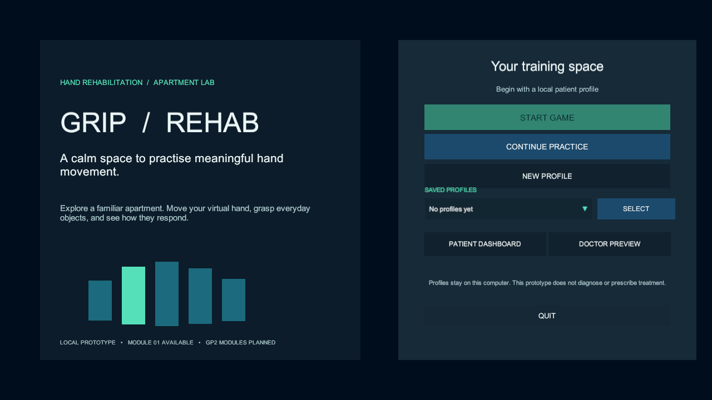
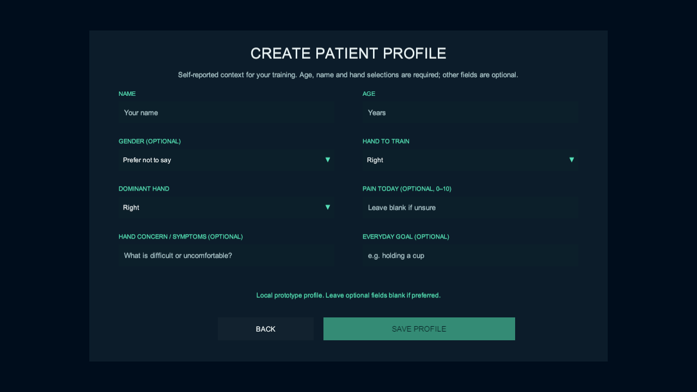

# واجهة Grip Rehab — دليل التشغيل والتعديل

افتح `E:\GP\codex\GripRehab-Unity` في Unity Hub بإصدار **6000.4.4f1**، ثم افتح `Assets/Scenes/GripRehab.unity` واضغط Play. تبدأ اللعبة بالقائمة الرئيسية، ويظل اللاعب متوقفًا ولا تُفتح الكاميرا حتى تدخل Module 01. أوقف Play قبل تعديل المشهد، ثم احفظه بـ Ctrl+S؛ تعديلات Play المعتادة لا تُحفظ.

## رحلة المستخدم

1. **START GAME**: إن لم يوجد ملف نشط يفتح إنشاء ملف مريض؛ وإلا يفتح اختيار الموديول.
2. **NEW PROFILE**: يسجل اسمًا وعمرًا واليد المراد تدريبها واليد المسيطرة. يمكن ترك الجنس، شدة الألم اليوم (0–10)، وصف صعوبة اليد، والهدف اليومي فارغة. تلك إجابات يكتبها المستخدم وليست قياسات أو تشخيصًا.
3. **SAVED PROFILES → SELECT**: يختار ملفًا محليًا موجودًا. لا توجد كلمة مرور أو حساب سحابي؛ لذا هذا اختيار ملف على نفس الجهاز، وليس تسجيل دخول آمنًا.
4. **CONTINUE PRACTICE**: يظهر فقط بعد دخول Module 01 مرة. يسترجع الغرفة والعنصر واليد ومصدر الإدخال. لا يسترجع مكان جسم أُسقط أو كُسر ولا تقدّم تمرين لحظي؛ لذلك سُمّي متابعة التدريب وليس استعادة عالم اللعبة بالكامل.
5. **PATIENT DASHBOARD**: يعرض بيانات الملف المختار وحقيقة وجود جلسة إعداد محفوظة. تاريخ القوة والنتائج السريرية مؤجلان إلى WBS 5.1.
6. **DOCTOR PREVIEW**: شاشة واضحة بأنها تخطيط لـ WBS 5.2؛ لا تعرض تاريخ مرضى أو توصيات مصطنعة.
7. **QUIT**: يوقف Play داخل Editor أو يغلق برنامج Windows المبني.

بعد الملف، تظهر ثلاث بطاقات. **FORCE + OBJECT / 01** وحده قابل للفتح. **COGNITIVE / 02** و**VISUOMOTOR / 03** ظاهران كخطة GP2 ومغلقان؛ لم تُضف لهما حركة لعب أو YOLO أو نتائج مزيفة. كذلك baseline assessment وfatigue-aware AI ولوحات القياس التفصيلية معروضة كخارطة طريق فقط، وفق `PROJECT_PLAN.md` و`docs/Hand_Rehab_Pipeline.pdf` في المشروع الأساسي.

## داخل Module 01

- الشريط العلوي يعرض الغرفة، اليد، مصدر الإدخال والقيمة: **% إغلاق بصري** مع الكاميرا، **N** مع القوة المقاسة الصالحة، أو **N محاكاة** في Keyboard Demo. نسبة الإغلاق ليست نيوتن. عند غياب عينة Phase 2 صالحة يظهر `-- N` و`NO FRESH SAMPLE`، ولا تتحول اللعبة تلقائيًا إلى قوة الكيبورد.
- زر **MAIN MENU** يحفظ إعدادات الجلسة الحالية، يترك الجسم المحمول، يغلق عامل الكاميرا، ويعود للقائمة.
- **TAB** أو **ESC** يفتح/يغلق لوحة الخيارات أثناء اللعب. اختر **LIVING ROOM** أو **KITCHEN**، ثم أحد العناصر الثلاثة المتاحة في الغرفة، واليد Right/Left، ومصدر الإدخال Camera / Demo / Phase 2. **RESUME** يعيد الحركة.
- **WASD** للحركة، الماوس للنظر، **F** للجلوس/الوقوف، **E** لالتقاط العنصر بلوحة المفاتيح، **Q** للإفلات، **G** لجلب العنصر إلى اليد المتعقبة في وضع الكاميرا، **B** لتبديل المصدر، **R** لإعادة العناصر. في Demo: Space/النقر للضغط، عجلة الماوس أو +/- لقيمة القوة، Shift لقوة أعلى، 1–5 للإصبع، J للمفصل، X/Z للثني/الفرد، الأسهم وPageUp/PageDown لتحريك اليد. في Camera: C لإعادة معايرة اتجاه الكف.
- مصدر القوة الحقيقي يستهدف جسر Phase 2 الحالي على UDP 27818، والـMediaPipe على 27817 ومعاينة 27819. افتح `Docs/BLE_INTEGRATION.md` و`Docs/HANDS_AND_MEDIAPIPE_AR.md` للتشغيل والتشخيص. المحاكاة لا تثبت اتصال Nano 33 IoT/HX711 فعليًا.

## أين تعدّل؟

| المطلوب | الملف/العنصر |
| --- | --- |
| ترتيب، ألوان ونصوص الواجهة | في Hierarchy: `Canvas → Rehab main menu overlay`، و`Gameplay top bar`، ولوحة الخيارات؛ العناصر محفوظة في المشهد وتُعدّل في Inspector |
| منطق الأزرار والتنقل | `Assets/Rehab/3.4-game-modules/RehabAppShell.cs` |
| حفظ الملفات واسترجاع نقطة المتابعة | `Assets/Rehab/3.4-game-modules/RehabProfileStore.cs` |
| الغرف والعناصر وأزرار الخيارات | `Assets/Rehab/3.4.1-force-object-interaction/Apartment/ApartmentChoices.cs` |
| قوة اليد والكاميرا والقيم المعروضة | `Assets/Rehab/3.4.1-force-object-interaction/Apartment/ApartmentExperience.cs` |
| منشئ الواجهة لمرة واحدة | `Assets/Editor/RehabShellAuthoring.cs`؛ لا تعِد توليد المشهد بعد تعديله يدويًا |

يُحفظ `profiles.json` محليًا تحت `Application.persistentDataPath/GripRehab` (في Windows عادةً داخل `%USERPROFILE%\AppData\LocalLow\Grip Rehab Capstone\Grip Rehab Unity\GripRehab`). النسخة الأولية نص JSON عادي مع نسخة `.bak`؛ لا تضع فيه بيانات مرضى حقيقية أو حساسة، ولا تعتبره نظام سجلات طبية أو حسابات آمنًا.

## ما تم التحقق منه وما بقي

اختبرنا مسارات إنشاء ملف ناقص وصحيح، حفظه، تبديل الملف النشط، قفل الموديولات، فتح Module 01، حفظ الإعدادات والمتابعة، فتح اللوحتين والرجوع، وثلاث دورات Play/Stop وتنظيف منافذ UDP. هذه اختبارات آلية مع بيانات محاكاة وبناء Windows. التشغيل السريري والقياس الفعلي من load cell والتجربة المباشرة ليد المستخدم ما زالت تحتاج اختبارًا منفصلًا. تفاصيل النتائج الدقيقة في `Docs/QA.md`.
