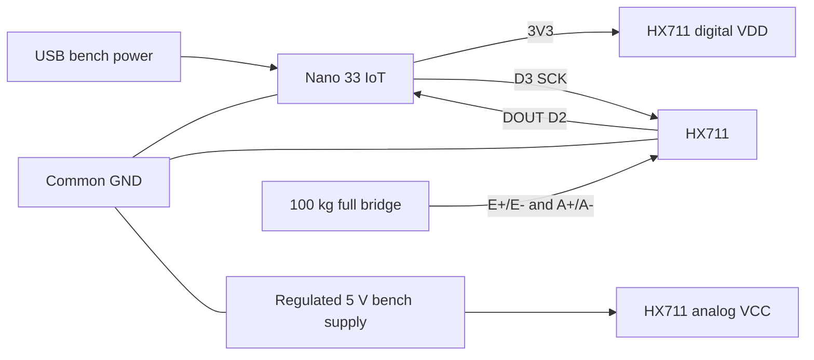

# 2.2 Circuit assembly and first-build guide

Status: wiring design, BOM and bench protocol prepared; no components owned, purchased or assembled. Start with a USB-powered bench prototype. The battery-integrated core must wait for the exact load-cell and battery/charger/boost selections listed below.

For named from-zero bench choices, see [STARTER_PARTS.md](STARTER_PARTS.md). It selects documented cell and power references and explicitly records why they do not yet fit the concept enclosure.

**R2 update:** use [REV2_CIRCUIT.md](REV2_CIRCUIT.md) for the selected compact TAL220. It changes bridge excitation wiring to meet the cell's published minimum; do not combine the R1 E+ connection with the R2 external excitation connection.

## Documented starting choices

Buy an **Arduino Nano 33 IoT (ABX00027)**, not a classic Nano or Nano 33 BLE. Use a **SparkFun HX711 Load Cell Amplifier (BOB-13879, split VCC/VDD rails)** or a manufacturer-documented equivalent. Obtain a **100 kg full-bridge load cell** only after checking its drawing, excitation range, sensitivity, mounting and fit. The PDF's pictured bar is unidentified. A Phidgets 3138 S-type is a documented 100 kg candidate but requires a different mount/envelope; it is not a direct replacement for the provisional CAD bay.

Sources: [Nano pinout](https://docs.arduino.cc/resources/pinouts/ABX00027-full-pinout.pdf), [Nano board](https://docs.arduino.cc/hardware/nano-33-iot/), [SparkFun wiring guide](https://learn.sparkfun.com/tutorials/load-cell-amplifier-hx711-breakout-hookup-guide/all), [SparkFun schematic](https://cdn.sparkfun.com/datasheets/Sensors/ForceFlex/SparkFun_HX711_Load_Cell_v11.pdf), [100 kg reference cell](https://www.phidgets.com/?prodid=229). Checked 2026-09-12; availability/prices not promised.

## Pin map, matching both sketches

| Net | Nano | HX711 / load cell | Notes |
| --- | --- | --- | --- |
| Digital logic rail | 3V3 | VDD | 3.3 V logic only; never connect DAT to a 5 V logic rail |
| Ground | GND | GND | Common signal/supply ground |
| Data | D2 | DAT / DOUT | HX711 data-ready and serial output |
| Clock | D3 | SCK / PD_SCK | Default low; library handles conversion read pulses |
| Analog supply | External regulated 5 V | VCC | Separate from VDD on the specified breakout; verify rail jumper configuration |
| Bridge excitation | none | E+ / E- -> sensor excitation pair | Use the actual manufacturer's wire labels, not assumed colors |
| Bridge signal | none | A+ / A- -> sensor output pair | Channel A, gain 128; reversed polarity is supported by signed calibration |
| Shield | none | board shield point as specified | Route away from converter/antenna; no guessed signal-wire substitutions |

Do not use the Nano's pin labelled +5V as a presumed regulated output: its VUSB jumper behavior differs from VIN. The Nano GPIO is not 5 V tolerant. The specified HX711 breakout permits separate analog and logic rails. A generic one-supply HX711 board must be checked separately before connection; this pin map is not a promise that all green HX711 modules are equivalent.

## Battery integration decision sheet

Planned topology: protected single-cell Li-ion -> compatible charge/protection and load-sharing board -> regulated 5 V boost -> switch -> Nano VIN and HX711 VCC. Nano 3V3 supplies HX711 VDD. Common ground. Use USB-only bench mode first; disconnect battery/boost output before plugging USB until reverse-current and power-path behavior has been verified for the actual modules. A charger, cell protection and load sharing are distinct functions; the words "power bank module" do not prove all three.

Specify cell part/capacity, allowed charge/discharge currents, connector polarity, boost input range/current capability, regulator efficiency, cutoff/protection and mounting before purchase. Calculate worst-case 5 V power from measured Nano BLE current + ADC/bridge draw; battery current estimate is `Pout / (minimum_battery_voltage * efficiency)`. Add documented design margin and verify converter startup/ripple and thermal rise. No runtime/capacity estimate is invented before measurements.

## From-zero build sequence

1. Obtain Nano, documented HX711, approved cell, micro-USB data cable, breadboard/connectors, multimeter and known calibration masses/fixture. Record tax invoices in `procurement.csv`.
2. Power Nano over USB alone; confirm board recognition and flash the calibration sketch. An absent sensor should time out without hanging the command interface.
3. With power removed, wire GND/D2/D3/VDD and verified analog supply. Check rail isolation, short circuits and bridge pair resistance against the selected sensor documentation.
4. With current limiting, measure 3.3 V VDD and regulated analog VCC before attaching data wiring; confirm DAT never exceeds the MCU logic rail. Record actual rail/current values in `bench_report.csv`.
5. Secure the cell correctly to a bench fixture using its drawing. Load the active end in the intended direction; do not clamp/bend the sensing section or load the plastic fit prototype.
6. Run shape selection, tare, known-force calibration, independent verification, save/readback and reboot checks in the firmware guide.
7. Flash BLE sketch, use the provided monitor, verify disconnect/timeout/stop behavior. Only then integrate electronics into the mechanically reviewed core and repeat whole-assembly calibration for each grip.

Acceptance evidence required: actual part list, schematic matching the assembled revision, photos, measured rails/current/ripple, valid calibration records, battery decision closure and no-load/fault checks. Until those exist, 2.2 is **design delivered; physical assembly pending**.
